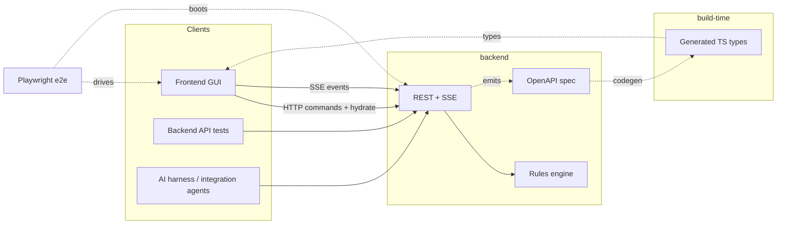

# Goblins & Gridirons — System Architecture

Cross-module picture for the monorepo: how packages sit together, what each owns, and where detailed design lives. **One** [implementation backlog](BACKLOG.md); **module** architecture docs under `backend/` and `frontend/`.

**Rules:** [`reference/rulebook-digest.md`](reference/rulebook-digest.md) · Cards: [`reference/cards.md`](reference/cards.md)

---

## Documents

| Doc | Audience | Status |
|-----|----------|--------|
| **This file** | Repo layout, module boundaries, client↔engine handshake | Living |
| [Backend architecture](backend/ARCHITECTURE.md) | Rules engine, domain model, REST/SSE API, testing | Primary reference |
| [Frontend architecture](frontend/ARCHITECTURE.md) | GUI client — stack, screens, event-fold state, assets, testing | Living |
| [Rules digest](reference/rulebook-digest.md) | Game rules for fidelity questions (not engine design) | Living |
| [BACKLOG.md](BACKLOG.md) | Ordered tasks (backend + future frontend notes as needed) | Single checklist |

---

## Repository layout

```text
goblins-and-gridirons/
├── ARCHITECTURE.md          ← this file (system)
├── BACKLOG.md               ← single backlog (backend Phases 0–9; frontend 10–15)
├── .cursor/rules/           ← shared Agent rules (git, scope, style, rulebook routing)
├── .cursorignore            ← binaries, art, build output, ai/.venv + ai/output
├── ai/                      ← Python SB3 harness; design/backlog under ai/
│   ├── .cursor/rules/       ← AI search routing + Python style
│   ├── gridiron_ai/        ← env, client, obs, reward
│   └── output/              ← generated (cursorignored — name a path to review)
├── backend/
│   ├── ARCHITECTURE.md
│   ├── .cursor/rules/       ← backend Agent rules (API, tests, domain, immutability)
│   ├── pom.xml
│   └── src/
├── frontend/                ← React/TS GUI client
│   ├── ARCHITECTURE.md
│   ├── .cursor/rules/       ← frontend Agent rules (TS style + scope)
│   └── src/
│       ├── api/generated/   ← TS types generated from backend OpenAPI (committed)
│       ├── state/           ← pure applyEvent fold + store
│       ├── render/          ← SVG pitch, tokens, HUD
│       └── assets/          ← tokens/cards/pitch + AssetRegistry
└── reference/               ← rules digest + card text (cards.md); local-only sources gitignored
```

- **Run the engine:** `cd backend && mvn test` (or `mvn spring-boot:run`).
- **Run the client:** `cd frontend && npm run dev`, or `./dev.sh` from the repo root to start backend + frontend together.
- **Full-stack e2e:** one script boots backend + frontend + Playwright ([Phase 15](BACKLOG-done.md#phase-15-full-system-e2e)).

---

## Module boundaries



The dashed edges are the **build-time contract**: the backend OpenAPI spec generates the frontend's TypeScript types, and the Playwright e2e harness boots and drives both modules. Solid edges are runtime traffic.

| Module | Owns | Does not own |
|--------|------|----------------|
| **backend** | Rulebook fidelity, `MatchState`, action resolution, HTTP API, SSE fan-out, domain/event store | Pixel UI, browser routing, client styling |
| **frontend** | Rendering, UX, calling the API / applying event patches locally | Encoding game rules in the client |
| **system** (this doc) | How those modules compose; shared contracts at the boundary | Domain internals (see backend) |

**Source of truth for rules:** the backend. The client displays state and submits commands; it should not re-implement legality beyond what `GET .../legal-actions` and events already convey.

---

## Client ↔ engine contract (summary)

Detailed DTO and stream design: [backend API design](backend/ARCHITECTURE.md#api-design) and [event stream](backend/ARCHITECTURE.md#event-stream-phase-9). Backlog Phases 8–9 are done.

**Join / reconnect (happy path):**

1. Static: `GET .../pitch`, `GET .../roster`
2. Hydrate: `GET .../snapshot` → `lastEventId` + HUD + pieces
3. Live: `GET .../events` with `Last-Event-ID` from the snapshot
4. Act: POSTs (`run`, `mark`, `throw`, …); stream (and/or inline `events`) patches the board
5. When `InputRequired` arrives → `GET .../legal-actions` → POST a command

**Auth / multiplayer seats / deployment topology** — not designed yet; call out in this file when they land. This is a **hobby project — no deployment, no cloud CI** today. The backend is **single-node with in-memory persistence**. The computer opponent runs **server-side** (`game/opponent/` — scripted, lookahead search, or ONNX policy; [AI1](BACKLOG-done.md#ai1--basic-computer-opponent)). "Opponent's turn" means a second human client or the server's computer coach acting; the client's event loop handles both.

### Shared contract — keep the two modules in lockstep

The frontend never hand-copies backend DTOs. The backend emits an **OpenAPI 3 spec**; the frontend generates **types-only** TypeScript from it (`openapi-typescript`) into `frontend/src/api/generated/`, with a local `gen:api:check` drift guard (no cloud CI) that fails on any regeneration diff. Polymorphic types (`DomainEvent`, `LegalAction`) carry a `kind` discriminator and must appear as `oneOf` + `discriminator` in the spec so they become TS discriminated unions. See [frontend § API & DTO synchronization](frontend/ARCHITECTURE.md#api--dto-synchronization) and [BACKLOG Phase 10b](BACKLOG-done.md#phase-10b-api-type-sync-tooling).

### Full-stack testing

- **Backend:** whole-stack API/system tests (Spring boots once) + pure domain tests — see [backend § Testing](backend/ARCHITECTURE.md#testing-strategy).
- **Frontend:** pure event-fold reducer tests + component black-box tests — see [frontend § Testing](frontend/ARCHITECTURE.md#testing).
- **System:** one Playwright script boots the real backend (seedable-RNG test profile), the real frontend, and drives a live match end-to-end — black box, no mocks ([Phase 15](BACKLOG-done.md#phase-15-full-system-e2e)).

---

## Product direction (high level)

Shipped: playable engine API, human GUI, and heuristic computer opponents. In progress: trainable AI ([`ai/`](ai/README.md)) served back to the engine as an ONNX opponent. Full product goals and engine milestones: [backend § Long-term product goals](backend/ARCHITECTURE.md#long-term-product-goals); deferred rules: [BACKLOG](BACKLOG.md) Future / D1–D4 / AI1–AI2.

---

## Related documents

- [Backend architecture](backend/ARCHITECTURE.md)
- [Frontend architecture](frontend/ARCHITECTURE.md)
- [BACKLOG.md](BACKLOG.md)
- [Rules digest](reference/rulebook-digest.md) · [Cards](reference/cards.md)
- [`.cursor/rules/`](.cursor/rules/) — shared Agent conventions (includes rules routing)
- [`backend/.cursor/rules/`](backend/.cursor/rules/) — Kotlin/Spring Agent conventions
