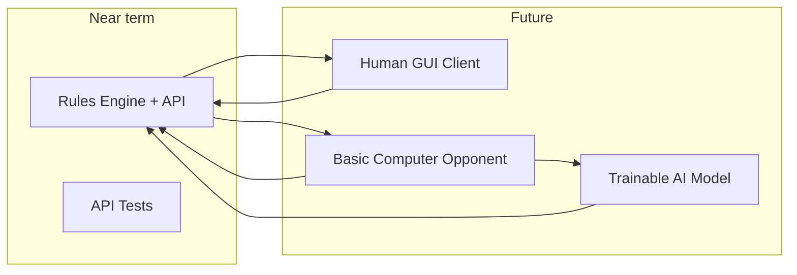
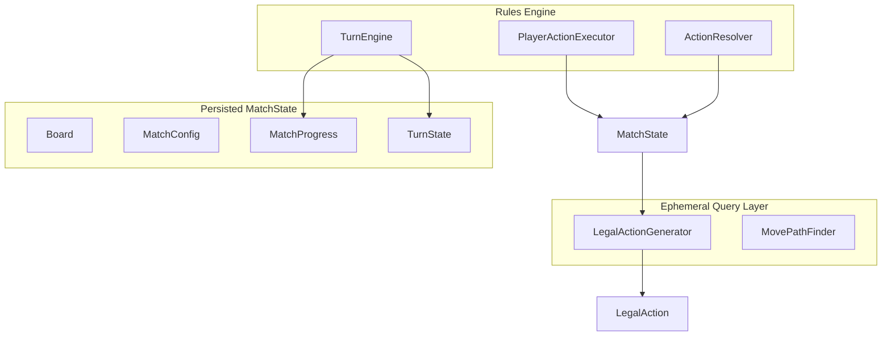
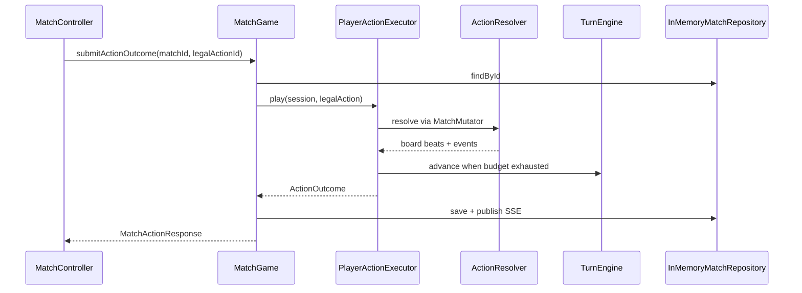
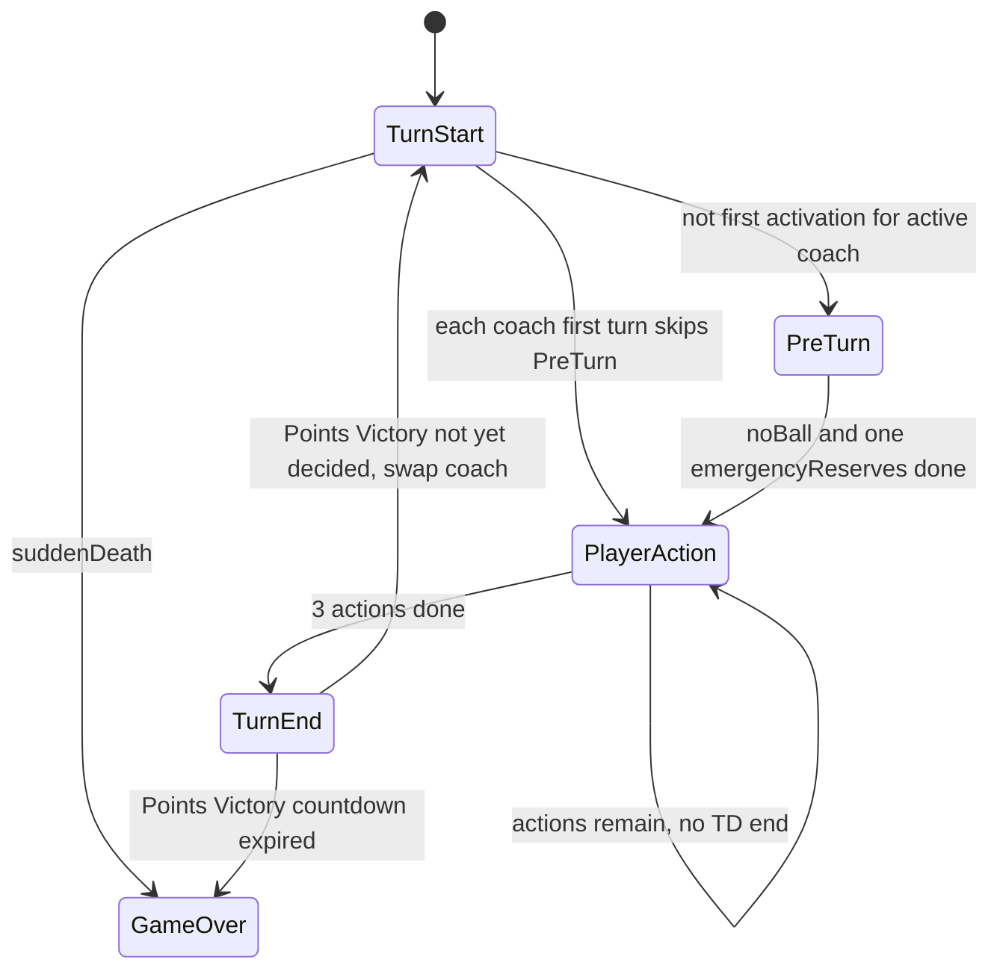
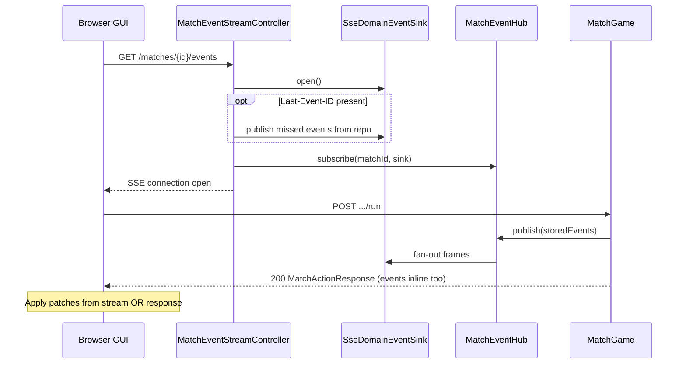

# Goblins & Gridirons — Backend Architecture

Domain-driven design blueprint for the **Goblins & Gridirons** rules engine in Kotlin/Spring. Boundaries, core models, immutability, HTTP API, and extension points for the base playable game.

**Rules (game text):** [`reference/rulebook-digest.md`](../reference/rulebook-digest.md) — not this file. Cards: [`reference/cards.md`](../reference/cards.md).

**Implementation backlog:** [BACKLOG.md](../BACKLOG.md) (single repo checklist)

**Sibling docs:** [System architecture](../ARCHITECTURE.md) · [Frontend architecture](../frontend/ARCHITECTURE.md)

**Module:** sources under this directory (`pom.xml` + `src/`). Run Maven here: `cd backend && mvn test`.

---

## Scope

### Base game (current target)

| Included | Excluded (deferred) |
|----------|---------------------|
| Core player actions: Run, Mark, Throw, Block, Sidestep, Stand Up, Reserves | Challenge / Bonus / Random Event cards |
| Throw, bounce, possession, multi-ball | Player abilities (Relentless, Ball Guard, etc.) |
| Blocking, assist, armour, injury; Foul; Throw Team-mate | Optional arenas, special balls |
| Touchdown scoring | Full 23 Team Cards |
| Sudden Death + Points Victory | GUI, AI opponent implementation |
| Dwarves and Orcs (box rosters; abilities per ability phase) | |

Product win conditions, pre-turn steps, and action rules: **[rulebook digest](../reference/rulebook-digest.md)**. Engine phases that implement them: [Turn sequence state machine](#turn-sequence-state-machine).

---

## Long-term product goals

The engine is designed to support three milestones beyond the base rules core:



| Goal | Description | Architectural requirement |
|------|-------------|---------------------------|
| **1. GUI** | Human plays via a client | REST commands + read APIs ([Phase 8](../archive/BACKLOG-done.md#phase-8-client-api--event-protocol)); optional **SSE** push for live updates ([Phase 9](../archive/BACKLOG-done.md#phase-9-async-client-protocol)). GUI is out of scope for base implementation — see [frontend architecture](../frontend/ARCHITECTURE.md). |
| **2. Basic computer opponent** | Heuristic bot selects from legal actions | `LegalActionGenerator` produces closed action set; `OpponentStrategy` port (Phase AI1) |
| **3. Trainable AI model** | RL-trained agent replaces heuristic bot | Serializable `MatchState`; stable action encoding (legal-action ids or features); optional `MatchEvent` log for state-action-reward traces (Phase AI2) |

**AI2 training surface (pointer only):** dedicated HTTP under `api/ai/` (packed obs/step/submit, training scenarios under `api/ai/training/`). Scenario placement, grading, and catalog semantics: [`TRAINING_SCENARIOS.md`](TRAINING_SCENARIOS.md). Python harness + phase docs live in [`ai/`](../ai/) — start at [`ai/OWNERSHIP.md`](../ai/OWNERSHIP.md). Do not restate the learning contract here; Kotlin DTOs + that map are the source of truth.

---

## Layering overview

```
┌─────────────────────────────────────────────────────────┐
│  api/          HTTP boundary + MatchGame persistence    │
│                (controllers, DTO mapping, SSE)          │
├─────────────────────────────────────────────────────────┤
│  game/         Playable match loop                      │
│    MatchSetup.kt — GAME_START state (roster in dugout)  │
│    action/     Resolvers, PlayerActionExecutor, events  │
│      utils/    Geometry & marking helpers               │
│      ability/  Player-ability hooks                     │
│    turn/       Turn crank, MatchMutator, phase clock    │
│    legalmoves/ Legal moves & paths (never persisted)    │
│    board/      BoardMutator, ASCII display              │
│    cards/      Challenge claim / bonus-play steps       │
│    opponent/   Computer coach strategy                  │
│    dice/       RNG port + check helpers                 │
├─────────────────────────────────────────────────────────┤
│  model/        Persisted aggregates + catalog data      │
├─────────────────────────────────────────────────────────┤
│  shared/       Cross-cutting value types (no Spring)    │
├─────────────────────────────────────────────────────────┤
│  spring/       Repository, Jackson, converters          │
└─────────────────────────────────────────────────────────┘
```

**One-sentence charters**

| Package | Charter |
|---------|---------|
| `api/` | HTTP in/out and the persistence boundary (`MatchGame`); no rules math. |
| `game/` | Everything that *plays* a match — setup, legal moves, resolution, turn crank, cards, bot. |
| `model/` | Immutable persisted match + catalog shapes only. |
| `shared/` | Small value types used by more than one of model / game / api. |
| `spring/` | Framework adapters (repo, Jackson, ID converters). |

**Dependency rule:** `model/` and `shared/` have zero Spring dependencies. `@Component` resolvers and engines live in `game/` / `api/` for wiring. `api/` depends on `model/`, `game/`, and `shared/`; `spring/` implements framework wiring and the in-memory repository at the edges.

**Create-match path (imports):** `MatchController` → `MatchGame.createMatch` → `DiceRoller` (coin toss / shuffle) → `MatchSetup` → `InMemoryMatchRepository.save` → snapshot DTOs via `api/mapping/`.

---

## Domain separation principles

### 1. Persisted state vs ephemeral computation

| Layer | Persisted? | Purpose |
|-------|------------|---------|
| `MatchState` | **Yes** | Single source of truth saved to `InMemoryMatchRepository` |
| Query results (`LegalAction`, `Path`, etc.) | **No** | Recomputed on every read; never serialized |

Ephemeral types live in `game/legalmoves`. Controllers load `MatchState`, call legal-move generators, return results. Caching legal-move results inside persisted state is forbidden — it creates stale-move bugs.

### 2. Physical board vs turn/phase flow

Persisted state splits into **spatial** and **temporal** parts composed on `MatchState`:

```kotlin
data class MatchState(
    val id: MatchId,
    val board: Board,              // WHERE things are
    val config: MatchConfig,       // frozen setup (coachA, teams, pitch)
    val progress: MatchProgress,   // scores, turn number, game result
    val currentTurnState: TurnState, // WHO / phase / action budget this activation
    val cards: CardState,          // challenge tableau, deck, discard, bonus hands (D1)
)
```

**`Board`** — spatial snapshot (what you would photograph on the table):

- Padded pitch grid (`Board.squares`) and per-team `ReservesArea`
- All `Player` instances (team, status, held ball — placement on board)
- All `Ball` instances (loose on square, held, or out of play)

**`MatchConfig`** — frozen at create (coin toss sets `coachA`; catalog ids for teams and pitch).

**`MatchProgress`** — cumulative match snapshot:

- `turnNumber` (increments once per coach activation at TurnEnd)
- `homeScore` / `awayScore`
- `result` when `phase == GAME_OVER`

**`TurnState`** — per-coach-activation clock:

- Active coach, current phase in the turn sequence
- Actions remaining (0–3), per-player actions used this turn
- Players whose turn ended early (Tackle/Miss on block)
- First-turn Pre-Turn skip is derived in `TurnEngine` from `turnNumber` + `coachA` (each coach’s first activation), not a persisted flag

**`CardState`** — challenge cards (D1.A–H shipped, incl. [D1.F.4](../archive/BACKLOG-done.md#d1f4--annotate-legal-actions-that-could-claim-a-challenge-2026-07)):

- Three active tableau slots, ordered deck (top visible), discard, per-coach bonus hands, claims-this-turn
- Seeded at match create (`MatchGame` shuffles via `DiceRoller`, `MatchSetup` receives dealt `CardState`)
- Public wire: challenge faces only (`ChallengeTableauDto`); hands stay seat-private (`toBonusHandDto`)

`MatchFlow` was removed (TD.5); legal-move queries take [TurnState] from the persisted match.

This split keeps spatial logic (pathfinding, marking, throw range) independent of sequential logic (whose turn, action budget).

### 3. Rules vs model vs legal moves

| Package | Contains | Mutates state? |
|---------|----------|----------------|
| `model` | Data types, value objects, enums | No |
| `game` | `MatchSetup`, action/turn/board/legalmoves/cards/opponent pipeline | Yes |
| `game.action.utils` | Marking, topology, throw/block geometry | No |
| `game.action` | Resolvers, `PlayerActionExecutor`, `DomainEvent` | Yes (via mutators) |
| `game.board` | `BoardMutator`, `renderBoard` | Yes (mutation accumulator; display is read-only) |
| `game.turn` | `TurnEngine`, `MatchMutator`, turn helpers | Yes (returns new `MatchState` + events) |
| `game.legalmoves` | Legal-move generators (build `api` `LegalAction` DTOs) | No |
| `game.cards` | Challenge refresh/claim, bonus-play windows | Yes (via `MatchMutator`) |
| `game.opponent` | Computer coach strategy | No (selects a legal action id) |
| `game.dice` | `DiceRoller` port, check functions | No (reads rolls, returns results) |

**Design for testability:** Legal-move and pure rule helpers should be callable **without Spring** — top-level functions or stateless `object`s taking `Board` (and `TurnState` when turn rules apply) in and returning results.

---

## Package layout

Folders exist only for significant branches — not one folder per entity.

See [Source file organization](#source-file-organization) for where to place IDs and enums.

### Data lifecycle — where types live

| Lifecycle | Package | Examples | On the wire |
|-----------|---------|----------|-------------|
| **Persisted state** | `model/` | `MatchState`, `Board`, `Player`, `MatchProgress`, `CardState` | Via snapshot / game-state DTOs — never raw `MatchState` on public GET (TD.8) |
| **Match setup** | `game/` | `MatchSetup` (pure state build); coin toss in `MatchGame` | Internal; create path |
| **Turn state** | `model/` | `TurnState` | Embedded in snapshot `gameState` |
| **Shared vocabulary** | `shared/` | See [shared inventory](#shared-package-inventory) | Primitives reused by DTOs and domain |
| **Legal moves** | `api/dto/response/` | `LegalAction` | `GET .../legal-actions`; generators in `game/legalmoves/` |
| **Shared rules** | `game/action/utils/` | topology, throw/block geometry, marking helpers | Pure helpers; not persisted |
| **Action pipeline** | `game/action/` | `PlayerActionExecutor`, `ActionResolver`, bounce/throw/block/run resolvers | `POST .../actions` with `LegalActionId` |
| **Events** | `game/action/dto/` | `DomainEvent`, `StoredDomainEvent` | Inline on action responses + SSE |
| **Board mutation** | `game/board/dto/` | `BoardMutator` | Internal to resolvers |
| **Board display** | `game/board/` | `renderBoard`, `renderBoardForDisplay` | Display not on HTTP |
| **Turn pipeline** | `game/turn/` | `TurnEngine`, `MatchMutator`, `TurnTracking` | Server-driven crank after each action |
| **Challenge cards** | `game/cards/` | `ChallengeTurnSteps`, claim eligibility, bonus windows | Tableau on snapshot; seat hand endpoint |
| **Computer opponent** | `game/opponent/` | `ScriptedOpponentStrategy`, `ComputerCoachAgent` | Create-match `CoachControl` |
| **Match DTOs** | `api/dto/request\|response/` | create/action/snapshot/catalog bodies | HTTP boundary types |
| **DTO mapping** | `api/mapping/` | snapshot, pitch, roster, challenge mapping | Internal to controllers |
| **Dice** | `game/dice/` | `DiceCheck`, `DiceRoller` port, `RandomDiceRoller` | Check math + RNG port |
| **Block die data** | `game/dice/dto/` | `BlockDieFace`, pool helpers | Die faces + roll composition |
| **Catalog data** | `model/catalog/` | `PitchCatalog`, `TeamCatalog`, challenge catalog | `GET /api/catalog/*` |
| **Match orchestration** | `api/` | `MatchGame` — load → play → save + publish | Controllers delegate mutations here |
| **Framework wiring** | `spring/` | `InMemoryMatchRepository`, `JacksonConfiguration`, `DomainIdConverters` | Not on HTTP |

### Ongoing* FSM pattern (Block / Throw / Run / Mark / Sidestep / …)

Multi-input actions keep one `Ongoing*` on a single `*Continuation` pending. Full rules: [`.cursor/rules/ongoing-fsm.mdc`](../.cursor/rules/ongoing-fsm.mdc).

- Stages are mid-action beats; opening rolls / budget setup live in `begin*` (no fake `ROLL_*` stage).
- Stage transitions and `updatePendingDecision(*Continuation)` stay **inline** in `mutate*State`’s `when (stage)` arms.
- Helpers apply board/dice/cards only — the FSM owns grants/outcomes (no applier side-offer detour).
- Mid-action park with **`updatePendingDecision`** over the current pick; TurnEngine **`setPendingDecision` into an empty slot**. `while` stops when `hasPendingDecision()` (prefer that over type filters).
- Mark: Slip Away mid-action; Momentum / All-In Tackle via `beginAfterOwnIfEligible` after Mark closes. Sidestep: Stick Close.

```
com.mhaefele.gridiron
├── api/
│   ├── MatchGame.kt, MatchController.kt, CatalogController.kt, …
│   ├── mapping/          # DTO mappers (not command adapters)
│   ├── dto/request/, dto/response/
│   └── stream/           # SSE hub
├── model/
│   ├── board/, catalog/
│   └── MatchState.kt, MatchProgress.kt, MatchConfig.kt, TurnState.kt, …
├── game/
│   ├── MatchSetup.kt
│   ├── action/ (+ dto/, utils/, ability/)
│   ├── turn/, legalmoves/, board/ (+ dto/)
│   ├── cards/, opponent/, dice/ (+ dto/)
├── shared/               # see inventory below
├── spring/
│   InMemoryMatchRepository.kt, JacksonConfiguration.kt, …
```

**Tests:** unit tests colocate with the code they exercise; HTTP tests live in `integration/` (not under production `api/`).

---

## Source file organization

**Agent rules** (placement conventions, validation annotations, type KDoc): [`.cursor/rules/kotlin-domain-files.mdc`](.cursor/rules/kotlin-domain-files.mdc). Speculative parameterization: [repo scope-discipline](../.cursor/rules/scope-discipline.mdc).

**Colocate by default;** extract a type to its own file only when multiple unrelated consumers need it. Inventory of where types live today:

| Placement | Types | Rationale |
|-----------|-------|-----------|
| `MatchState.kt` | `MatchState` | Match aggregate root |
| `MatchProgress.kt` | `MatchProgress`, `MatchResult`, `Score` | Scores, turn number, game over |
| `MatchConfig.kt` | `MatchConfig` | Frozen setup parameters |
| `TurnState.kt` (`model/`) | `TurnState` | Per-coach-activation clock on `MatchState` |
| `board/Board.kt` | `Board`, `BoardDefinition`, `ReservesArea` | Layout template + runtime pitch snapshot |
| `board/Player.kt` | `Player`, `PlayerStatus` | Tokens on pitch / in dugout |
| `board/Ball.kt` | `Ball`, `BallId` | Ball in play |
| `catalog/CatalogIds.kt` | `TeamCatalogId`, `PitchDefinitionId` | Catalog lookup keys |
| `catalog/TeamCard.kt` | `TeamCard`, `PositionProfile` | Team card roster for match setup |
| `catalog/StatLine.kt` | `StatLine`, `MoveValue`, `ThrowStat`, `ArmourStat` | Roster stat vocabulary |
| `BoardMutator.kt` (`game/board/dto/`) | `BoardMutator` | Mutable board accumulator — one beat, one event; shares the event log with `MatchMutator` |
| `MatchMutator.kt` (`game/turn/`) | `MatchMutator` | Whole-state accumulator (board + turn + progress) for one state-changing operation |
| `BoardRenderer.kt` (`game/board/`) | `renderBoard`, `renderBoardForDisplay` | ASCII display for tests and playthrough |
| `Marking.kt` (`game/action/utils/`) | marking helpers | Open/Marked derivation |
| `Topology.kt` (`game/action/utils/`) | `distance`, `neighbors`, `shortestPath` | Pitch geometry |
| `LegalAction.kt` (`api/dto/response/`) | `LegalAction` sealed hierarchy | `GET .../legal-actions` response type |
| `DomainEvent.kt` (`game/action/dto/`) | `DomainEvent` | Ordered resolution audit log |
| `ActionOutcome` (`api/MatchGame.kt`) | `ActionOutcome` | Persist/publish envelope (`newState` + `events`) |

### Shared package inventory

Every type in `shared/` has **multiple consumers** across model / game / api (or persistence IDs used at several boundaries). Display-only DTO fields stay on DTOs — do not put whole aggregates here.

| File | Type | Why shared |
|------|------|------------|
| `Coordinate.kt` | `Coordinate` | Grid indexing — board, paths, DTOs, legal moves |
| `Path.kt` | `Path` | Ordered movement path (includes start) — legal moves + events |
| `Direction.kt` | `Direction` | Bounce chart + adjacency; never persisted |
| `TeamSide.kt` | `TeamSide` | HOME / AWAY — board, turn, setup, API |
| `TurnPhase.kt` | `TurnPhase` | Turn clock phase enum |
| `StandingStatus.kt` | `StandingStatus` | Open/Marked derivation input |
| `ActionType.kt` | `ActionType` | Shared verb — legal moves, turn tracking, events |
| `ThrowRange.kt` | `ThrowRange` | Throw check bands — legal actions, pending, dice events, resolvers |
| `CoachControl.kt` | `CoachControl` | HUMAN / COMPUTER seat — config, create request, bot |
| `PlayerId.kt` | `PlayerId` | Board, actions, events, DTOs |
| `MatchId.kt` | `MatchId` | API, repo, aggregate |
| `LegalActionId.kt` | `LegalActionId` | Legal-actions submit + OpenAPI / converters |
| `DomainId.kt` | `DomainId` | Shared ID contract for typed ids / catalog keys |
| `DomainEventId.kt` | `DomainEventId` | Per-match monotonic event sequence (SSE / store) |

When unsure: start colocated; extract when a second consumer outside the same aggregate appears.

---

## Conceptual boundaries



| Concern | Key types | Backlog phase |
|---------|-----------|---------------|
| Board / pitch | `Board`, `BoardDefinition`, `BoardSquare`, `Coordinate`, `ReservesArea` | Phase 1 |
| Players | `Player`, `PlayerStatus`, `StatLine`, `PositionProfile` | Phase 1 (layout), Phase 4 (roster stats) |
| Topology / paths | `MovePathFinder`, marking, adjacency | Phase 2 |
| Balls | `Ball`, possession rules | Phase 1, Phase 4 |
| Query | `LegalAction`, `MovePath`, legal move enumeration | Phase 3 |
| Match aggregate | `MatchState`, `TurnState`, `MatchProgress`, `MatchConfig`, `TurnPhase`, `Score` | Phase 5 |
| Actions | `LegalActionId` submit, `ActionOutcome`, resolvers | Phase 4 |
| Combat | `BlockResult`, `KnockDownContinuation`, `ArmourCheckContinuation`, `Injury` | Phase 4 |
| Dice | `DiceRoller`, `ThrowCheck`, `ArmourCheck` | Phase 4 |
| Turn orchestration | `TurnEngine`, `MatchSetup`, win checks | Phase 5 |

**Deferred contexts** (documented in backlog; no placeholder package — interfaces land when each phase starts):

- `CardSystem` — challenge refresh/claim turn wiring → [BACKLOG Phase D1](../BACKLOG.md#phase-d1-challenge-cards) (D1.A–H shipped, incl. [D1.F.4](../archive/BACKLOG-done.md#d1f4--annotate-legal-actions-that-could-claim-a-challenge-2026-07) + [FF.10](../archive/BACKLOG-done.md#ff10--challenge-earn-cue-on-legal-actions-gui-2026-07))
- `AbilitySystem` — player special rules → [D2 closed](../archive/BACKLOG-done.md#d2--player-abilities-phase-closed-2026-07) (PA.* / D1.G shipped)
- `OpponentStrategy` — bot / ML → [BACKLOG Phase AI1–AI2](../BACKLOG.md#deferred--phase-ai1-basic-computer-opponent)

---

## Core domain models

### Shared value types

Full list: [shared package inventory](#shared-package-inventory). Examples:

```kotlin
// Coordinate.kt — 0-based grid; y=0 is HOME end zone (see KDoc on type)
data class Coordinate(
    @field:Min(0) val x: Int,
    @field:Min(0) val y: Int,
)

// TeamSide.kt — Coach A = HOME (sets up first)
enum class TeamSide { HOME, AWAY }

// legal/Direction.kt — D8 bounce chart; d8Value 1–8; never persisted
enum class Direction(val d8Value: Int) { N(1), NE(2), E(3), SE(4), S(5), SW(6), W(7), NW(8) }

// ActionType.kt
enum class ActionType { RUN, MARK, THROW, BLOCK, SIDESTEP, STAND_UP, RESERVES }
```

Colocated examples:

```kotlin
// DomainId.kt — shared contract; each ID is a distinct data class (free equals/hashCode/toString)
sealed interface DomainId {
    val value: String
}

// Player.kt
data class PlayerId(override val value: String) : DomainId
enum class PlayerStatus { /* Standing, Prone, Reserves */ }

// Ball.kt
data class BallId(override val value: String) : DomainId

// MatchState.kt
data class MatchId(override val value: String) : DomainId
```

### StatLine and PositionProfile

Player stats come from Team Cards. Stat meanings (`-` Throw / Armour, etc.): [rulebook digest](../reference/rulebook-digest.md).

```kotlin
data class StatLine(
    val move: Int,              // or RandomMove (D6 each Run Action)
    val blockDiceCount: Int,    // number of Block Dice rolled
    val throw: ThrowStat,       // Int threshold or Unthrowable
    val armour: ArmourStat,     // Int threshold or NoArmour
)

data class PositionProfile(
    val name: String,           // e.g. "Lineman", "Blitzer"
    val stats: StatLine,
    // abilities: deferred — no field in base game
)

data class TeamCard(
    val id: String,
    val name: String,
    val emergencyReserves: Int,
    val roster: List<PositionProfile>,  // one entry per miniature (6 players)
)
```

### Starter teams: Dwarves and Orcs (base game)

Hard-coded in `GridironTeamCatalog` — the two box teams from the Ultimate Edition. Roster numbers and abilities: catalog + [rulebook digest](../reference/rulebook-digest.md) / ability enum text. No JSON catalog of the other 21 teams yet.

### PlayerStatus and Player

Status drives allowed actions ([digest](../reference/rulebook-digest.md)). **Marked** is derived from board adjacency, not stored — `Player.status` stores only `Standing` (Open/Marked computed) | `Prone` | `Reserves`.

```kotlin
enum class StandingStatus { OPEN, MARKED }  // derived at legal-move time

sealed interface PlayerStatus {
    data class Standing(val derived: StandingStatus) : PlayerStatus
    data object Prone : PlayerStatus
    data object Reserves : PlayerStatus
}

data class Player(
    val id: PlayerId,
    val team: TeamSide,
    val profile: PositionProfile,
    val status: PlayerStatus,
    val heldBallId: BallId?,
)
// Grid position: BoardSquare.playerId or ReservesArea.playerIds
```

### Board and placement

**Reference direction:** `Board` → squares / reserves → occupant ids. Player and ball *attributes* live in side maps; *placement* lives on the board.

```kotlin
data class BoardDefinition(
    val playWidth: Int,
    val playHeight: Int,              // @Min(2) — distinct HOME/AWAY end-zone rows
    val trapdoors: Set<Coordinate>,     // grid coordinates in playable interior
    val blockedSquares: Set<Coordinate>,
)

// Padded grid: playable interior is x ∈ [1, playWidth], y ∈ [1, playHeight].
// One-square OutOfBoundsSquare border as real map entries. Path/bounce steps stop at OOB
// squares — never call squareAt with off-map coordinates. BoardDefinition builds the map;
// runtime Board has no definition reference.

sealed class BoardSquare {
    abstract val coordinate: Coordinate
    abstract val playerId: PlayerId?
    abstract val looseBallId: BallId?
}

// Subclasses: OutOfBoundsSquare, EndZoneSquare, FieldSquare, BlockedSquare, TrapdoorSquare
// Query via square: isBlocked(), isTrapdoor(), isEndZone(team); OOB via type or movement rules

data class ReservesArea(val playerIds: List<PlayerId>)

data class Board(
    val squares: Map<Coordinate, BoardSquare>,
    val reserves: Map<TeamSide, ReservesArea>,
    val players: Map<PlayerId, Player>,
    val balls: Map<BallId, Ball>,
)
```

**Engineering constraints** (rule meanings in the [digest](../reference/rulebook-digest.md)):

- End-zone rows at `y = 1` (HOME) and `y = playHeight` (AWAY) on the padded grid
- Occupancy: player ids and loose-ball ids on squares; held ball on `Player.heldBallId`
- `reserves: Map<TeamSide, ReservesArea>` — players only, no balls
- **Padded border:** one [OutOfBoundsSquare] ring — real [Board.squareAt] keys so path/bounce/adjacency step without index guards. Border squares are **impassable** (`isBlocked()`)
- Adjacency = 8 directions; off-map [Board.squareAt] throws

Exact play-area dimensions are **data-driven** via `BoardDefinition` / `PitchCatalog`.

### Ball

```kotlin
data class Ball(val id: BallId)
```

Loose vs held vs out-of-play: [digest](../reference/rulebook-digest.md). Engine: loose on `BoardSquare.looseBallId`, held on `Player.heldBallId`, removed by dropping from `balls` and clearing refs.

### Turn and match progress

```kotlin
enum class TurnPhase {
    TURN_START,       // sudden death check
    PRE_TURN,         // no ball, emergency reserves
    PLAYER_ACTION,    // one of up to 3 actions
    TURN_END,
    GAME_OVER,
}

data class TurnState(
    val phase: TurnPhase,
    val activeCoach: TeamSide,
    val actionsRemaining: Int,        // 0–3 during PLAYER_ACTION phase
    val actionsUsedThisTurn: Map<PlayerId, Set<ActionType>>,
    val turnEndedPlayers: Set<PlayerId>,  // Tackle/Miss block ended their turn
)

data class MatchProgress(
    val turnNumber: Int,
    val homeScore: Score,
    val awayScore: Score,
    val result: MatchResult?,         // non-null when GAME_OVER
)

data class MatchConfig(
    val coachA: TeamSide,             // coin-toss loser — sets up first, acts first
    val homeTeamId: String,
    val awayTeamId: String,
    val pitchDefinitionId: String = "default",
)

sealed interface MatchResult {
    data class SuddenDeath(val winner: TeamSide) : MatchResult
    data class PointsVictory(val winner: TeamSide?) : MatchResult  // null = draw
}
```

**Turn numbering:** `progress.turnNumber` increments once per coach activation at `TurnEnd`. Pre-Turn is skipped on each coach’s first activation (`turnNumber == 1` for Coach A, `turnNumber == 2` for Coach B).

**Phase advancement:** The client never POSTs `advance-turn`. Action POST handlers run `ActionResolver` during `PLAYER_ACTION`; when the action budget is exhausted or the turn ends, `TurnEngine` advances through `TurnEnd` → coach swap → `TurnStart` → optional `PreTurn` → next `PLAYER_ACTION` before returning state.

### Score

```kotlin
data class Score(val points: Int) {
    fun addTouchdown(): Score = copy(points = points + 4)
    fun leadOver(other: Score): Int = points - other.points
}
```

Scoring rules and track: [digest](../reference/rulebook-digest.md). Base game stores a single integer per team.

### MatchState

```kotlin
data class MatchState(
    val id: MatchId,
    val board: Board,
    val config: MatchConfig,
    val progress: MatchProgress,
    val currentTurnState: TurnState,
    val cards: CardState,
)
```

All state transitions return a new `MatchState`. No in-place mutation.

---

## Legal moves

These types are **never** part of `MatchState` or persisted JSON.

**Board geometry** stays Spring-free pure functions in `game/legalmoves` (per-action helpers: `runMoves`, `blockTargets`, paths, …) so unit tests can call them without booting the app. Selecting-`RegularPlayerAction` owns action-type enumeration in `RegularPlayerActionLegalMovesGenerator` (then calls those geometry helpers).

**Pending-scoped menus** live next to resolvers: one `*LegalMovesGenerator` per concrete `PendingDecision` under `game/action/pending/<action>/`, extending `PendingDecisionLegalMovesGenerator`. Parents manually `when`-delegate into child generators (same shape as `*Resolver`). Match entry is `LegalMovesGenerator` (mirrors `PlayerActionExecutor`):

```kotlin
// game/legalmoves — per-action geometry
fun runMoves(player: Player, board: Board, bonuses: PathBonusFlags = PathBonusFlags()): List<LegalAction>

// RegularPlayerActionLegalMovesGenerator — type enum + turn/hand; geometryMoves for deepen/tests
regularPlayerActionLegalMovesGenerator.geometryMoves(player, board)

// game/legalmoves/LegalMovesGenerator.kt — Spring; root pending when-dispatch
legalMovesGenerator.forActingCoach(state)
legalMovesGenerator.forSettle(state)

// api/MatchGame — real-match API façade (viewer soft-empty lives here)
matchGame.legalActions(matchId)
matchGame.legalActions(state)           // cached by (matchId, lastEventId); invalidated on save/evict
matchGame.legalAction(state, legalActionId)  // id lookup from that cached menu
matchGame.legalActionsForViewer(state, seat)
```

`MovePathFinder` and related helpers stay `(board, …) -> result`.

```kotlin
sealed interface LegalAction {
    val playerId: PlayerId
    val actionType: ActionType
    val targetCoordinate: Coordinate

    sealed interface PathMovement : LegalAction {
        val path: MovePath
        override val targetCoordinate: Coordinate get() = path.squares.last()
    }

    data class Run(val playerId: PlayerId, val path: MovePath) : PathMovement
    data class Mark(val playerId: PlayerId, val path: MovePath) : PathMovement
    data class Sidestep(val playerId: PlayerId, val path: MovePath) : PathMovement
    data class Throw(val playerId: PlayerId, val target: ThrowTarget) : LegalAction
    data class Block(val playerId: PlayerId, val destination: Coordinate) : LegalAction
    data class StandUp(val playerId: PlayerId, val targetCoordinate: Coordinate) : LegalAction
    data class Reserves(val playerId: PlayerId, val placement: Coordinate) : LegalAction
}

data class MovePath(val squares: List<Coordinate>)  // ordered path, includes start

data class ThrowTarget(
    val destination: Coordinate,
    val range: ThrowRange,       // SHORT | LONG
    val obstructed: Boolean,
    val isHandOff: Boolean,
)
```

`LegalMovesGenerator.forActingCoach` returns the active coach's legal actions and respects action budget, turn-ended players, and same-action-once rule. Which actions each status may take, and turn-budget rules: [digest](../reference/rulebook-digest.md).

---

## Dice and checks

### DiceRoller port

```kotlin
interface DiceRoller {
    fun d6(): Int
    fun d8(): Int
    fun blockDice(count: Int): List<BlockDieFace>
}
```

`ScriptedDiceRoller` (`@Profile("test", "scripted-dice")`) is the shared scripted RNG: profile `test` sets `fallback-to-default-pattern=false` (throw when a queue is empty); `scripted-dice` leaves the default `true` (repeating D6/D8/block patterns) and exposes `POST /api/test/dice/{d6|d8|block}` under `api.testonly`. Production keeps `RandomDiceRoller` only.

Check thresholds, natural 1/6, modifier cap, and Block Dice faces/effects: [digest](../reference/rulebook-digest.md).

---

## Action resolution pipeline



### Submitting an action

Clients do **not** post a free-form command DTO. Flow:

1. `GET .../legal-actions` → sealed `LegalAction` list (each has a `LegalActionId`)
2. `POST .../actions` with that id → `MatchGame.submitActionOutcome` → `PlayerActionExecutor` / resolvers mutate via `MatchMutator`
3. Response / SSE carry ordered `DomainEvent`s; persist envelope is `ActionOutcome(newState, events)` on `MatchGame`

Block targets a **square** (opponent on that square implied). Shove follow-up is shipped ([F.3](../archive/BACKLOG-done.md#f3--block-shove-follow-up)).

Action effects (Run / Mark / Throw / Bounce / Block / Touchdown): [digest](../reference/rulebook-digest.md). Resolvers and mutators implement that text; do not restate it here.

---

## Turn sequence state machine



Phase order and sudden-death / pre-turn / TD rules: [digest](../reference/rulebook-digest.md).

1. **TurnStart** — Sudden Death check → optional `GameOver`
2. **PreTurn** — skipped on each coach’s first activation; otherwise no-ball (bounce) + **one** emergency reserves offer
3. **PlayerAction** — up to 3 actions: validate → resolve → touchdown check
4. **TurnEnd** — Points Victory countdown / end check; else swap coach

After both coaches finish initial End Zone placement, a kickoff ball is placed on a trapdoor **without** bounce (distinct from New Ball!).

---

## Immutability strategy

**Decision (hybrid — keep):** persisted `model/` stays immutable; one operation’s working state uses mutable accumulators that rewrite snapshots underneath and append `DomainEvent`s. Full copy-on-every-helper CoW ceremony is **not** the preferred style.

1. **Persisted `model/` is immutable** — `data class`, sealed interfaces, value-class IDs. Repository stores frozen `MatchState` snapshots.
2. **Working state is a mutation accumulator** — [`BoardMutator`](src/main/kotlin/com/mhaefele/gridiron/game/board/dto/BoardMutator.kt) (board-only) and [`MatchMutator`](src/main/kotlin/com/mhaefele/gridiron/game/turn/MatchMutator.kt) (board + turn + progress + one shared event log). Call named verbs; read `events` / `toMatchState` only when the operation finishes.
3. **Edge envelope** — `ActionOutcome(newState, events)` at `MatchGame` for persist + publish. Prefer that over bespoke `*Result` tuples or parallel `d8Rolls` lists (dice are `DomainEvent.DiceRolled`).
4. **Derived state computed on read** — marking, Open/Marked, assist eligibility, legal actions.
5. **Legal set is the command** — clients submit a `LegalActionId` from `GET .../legal-actions`; do not re-accept arbitrary geometry because the UI looked legal.
6. **RNG via injected port** — never call `Random` directly in rules code.
7. **Extension hooks stay pure** where possible — ability/card modifiers return effects; mutators apply them.

**Smell to avoid:** returning copies from helpers so the caller can `var x = f(x)` line-by-line, or out-params like the old `blockerTurnEnded`. Use the mutator instead.

**Agent rules** (fail-fast, border squares, accumulators, collections): [`.cursor/rules/immutability.mdc`](.cursor/rules/immutability.mdc). Shipped resolution shape: [TD.4](../archive/BACKLOG-done.md#td4--standardize-mutationresolver-return-values-2026-07-triage) / [TD.7](../archive/BACKLOG-done.md#td7--stateresolution-for-board--turn-side-effects-2026-07-triage); true event-fold [won't do](../archive/BACKLOG-done.md#td9--event-driven-turn-and-progress-updates-wont-do).

---

## Application layer

### Entry points (`api/`)

State-changing routes delegate to [MatchGame](src/main/kotlin/com/mhaefele/gridiron/api/MatchGame.kt); most read routes query the repository and mappers directly in the controller. Legal-action menus for real matches go through `MatchGame` (`legalActions` / `legalActionsForViewer`) so soft-empty viewer menus stay out of `LegalMovesGenerator`. No persistence in the controller.

| HTTP | Responsibility |
|------|----------------|
| `POST /api/matches` | `MatchGame.createMatch` (coin toss, setup, save) → `CreateMatchResponse` (`GAME_START` snapshot) |
| `POST /api/matches/{id}/start` | `MatchGame.startMatch` → `MatchActionResponse` (kickoff crank; usually `PIECE_PLACEMENT`) |
| `GET /api/matches/{id}/snapshot` | Controller reads `repository.findById` → `toMatchSnapshotDto` (`lastEventId` + HUD + pieces) |
| `GET /api/matches/{id}/pitch` | Controller reads `repository.findById` → `toPitchLayoutDto` |
| `GET /api/matches/{id}/roster` | Controller reads `repository.findById` → `toMatchRosterDto` |
| `GET /api/matches/{id}/legal-actions` | `MatchGame.legalActions` → `LegalMovesGenerator.forActingCoach` |
| `GET /api/matches/{id}/events` | **Phase 9** — SSE subscription; see [Event stream](#event-stream-phase-9) |
| `POST /api/matches/{matchId}/players/{playerId}/run` (etc.) | `MatchGame.submitActionOutcome` → `MatchActionResponse` (`snapshot` + events) |

[MatchGame](src/main/kotlin/com/mhaefele/gridiron/api/MatchGame.kt) is the single place that changes and persists match state — it loads, runs the [TurnEngine](src/main/kotlin/com/mhaefele/gridiron/game/turn/TurnEngine.kt) crank, then saves state and appends/publishes events. It is also the API façade for legal-move menus on real matches; computer opponent / training / lookahead keep calling `LegalMovesGenerator` directly. Other queries do not go through it. Test helpers (`MatchBootstrap`) persist via the repository directly for fixtures.

#### Anti-pattern: pass-through service

```kotlin
// SMELL: controller adds nothing; exists only to satisfy layering
@RestController
class MatchController(private val matchService: MatchService) {
    @PostMapping("/{id}/run")
    fun run(...) = matchService.submitRun(...)
}

@Service
class MatchService {
    fun submitRun(...) { ... }  // duplicate of the route
}
```

Prefer a meaningful application component (`MatchGame`) that owns persistence, with thin controllers — not a 1:1 route mirror.

### Match persistence

`InMemoryMatchRepository` — thread-safe `ConcurrentHashMap` for dev. Persist only `MatchState`; never `LegalAction` lists. No repository interface — swap the implementation in place when storage changes.

**Per-match write lock (AI1.5):** `MatchGame` serializes load→mutate→save per `MatchId` (`ReentrantLock` map). Correct seating is human XOR computer per seat; the lock is a safety net if writers race. SSE `publish` runs **after** the lock is released so listeners (computer coach) never re-enter while holding it.

### API design

**Full guide:** [API-DESIGN.md](API-DESIGN.md). **Agent gate:** [`.cursor/rules/api-design.mdc`](.cursor/rules/api-design.mdc).

Wire contract summary for clients: [system architecture](../ARCHITECTURE.md#client--engine-contract-summary). Endpoint table and SSE design follow below.

### Event stream (Phase 9)

**Goal:** Push the same ordered [DomainEvent](src/main/kotlin/com/mhaefele/gridiron/game/action/dto/DomainEvent.kt) list clients already get inline on action POSTs — but over a **persistent server → client channel** so UIs can update live without polling.

#### Transport choice: SSE on Spring MVC (not WebSocket, not WebFlux)

| Option | Verdict | Why |
|--------|---------|-----|
| **Server-Sent Events (SSE)** | **Use** | First-class web standard (`text/event-stream`); browsers ship **`EventSource`**; server→client matches our shape (commands stay on existing REST POSTs). |
| **Spring MVC `SseEmitter`** | **Use** | First-class in `spring-boot-starter-web` (our stack). No reactive migration. Java 21 virtual threads make “one thread per open stream” acceptable at game scale (few subscribers per match). |
| **WebSocket / STOMP+SockJS** | Skip v1 | Bidirectional wire not needed; worse proxy/auth story; no built-in reconnect; extra client libs vs native SSE. |
| **Spring WebFlux `Flux<ServerSentEvent>`** | Skip | Best at huge connection counts on Netty — overkill while persistence is in-memory MVC and fan-out per match is tiny. |
| **Long polling** | Skip | Not a first-class browser primitive. |

**Browser clients:** native [`EventSource`](https://developer.mozilla.org/en-US/docs/Web/API/EventSource) when cookie/session auth suffices; for Bearer tokens use fetch-based SSE (`@microsoft/fetch-event-source` or similar) — same wire format, works in React/Vue/Svelte hooks.

#### Wire protocol

```http
GET /api/matches/{matchId}/events
Accept: text/event-stream
Last-Event-ID: 41        # optional on reconnect
```

```text
id: 42
event: playerMoved
data: {"kind":"playerMoved",...}

```

- **`id`** — per-match `DomainEventId.domainId` (`Last-Event-ID` resumption).
- **`event`** — `DomainEvent.kind`.
- **`data`** — same JSON as action POST `events[]`.
- **Heartbeat** — `: ping` comment every ~30s; `X-Accel-Buffering: no` behind nginx.

**Reconnect (v1):** controller reads `Last-Event-ID`, loads missed events from `InMemoryDomainEventRepository`, and publishes them onto the new `SseDomainEventSink` before registering for live fan-out. Hub never sees replay.

**Dual delivery:** action POSTs keep inline `events` + `snapshot`; the stream is additive for live UIs.

#### Server components

```text
MatchGame → append → MatchEventHub.publish → MatchEventChannel → SseDomainEventSink(s)
GET .../events → open sink → (optional repo replay onto sink) → hub.subscribe → return emitter
```

| Component | Role |
|-----------|------|
| `SseDomainEventSink` | One client — SSE frames, heartbeat, disconnect cleanup |
| `MatchEventChannel` | Fan-out list for one match |
| `MatchEventHub` | Find channel by `matchId`; live publish only |
| `InMemoryDomainEventRepository` | Monotonic `domainId`; reconnect replay source |
| `MatchEventStreamController` | Open sink, optional replay, subscribe, return emitter |
| `MatchGame` hook | Append stored events, publish same list returned inline on action POSTs |

**Tests:** `SseTestClient` in `integration/support/` — HTTP client reads stream lines; assert POST run → ordered SSE frames.

#### Why SSE + `SseEmitter` (not alternatives)

**Problem shape:** coaches **command** via existing REST POSTs; the server **notifies** observers with ordered `DomainEvent` patches. That is classic **server → client push** over HTTP — exactly what SSE was designed for.

**Spring MVC `SseEmitter`** ([docs](https://docs.spring.io/spring-framework/reference/web/webmvc/mvc-ann-async.html#mvc-ann-async-sse)) is wrapped by **`SseDomainEventSink`** so channel/hub stay free of wire details.

**Do not use `ApplicationEventPublisher` as the client transport.** Spring application events are in-process and not scoped to HTTP subscribers — fine for internal decoupling, but this stack owns live fan-out; reconnect replay is controller + repository.

**WebSocket / STOMP** add a second protocol, session semantics, and often SockJS fallbacks. We do not need browser → server messages on the stream (commands already POST). STOMP shines for chat/broker patterns, not “replay my last 40 board patches.”

**WebFlux `Flux<ServerSentEvent<T>>`** is the reactive equivalent — excellent at massive fan-out on Netty, but forces a stack split (or full reactive migration) while our game loop, repository, and tests are servlet/MVC today.

#### End-to-end flow



#### Stream fan-out design (v1)

```kotlin
class SseDomainEventSink { fun publish(stored: StoredDomainEvent) }       // one consumer
class MatchEventChannel { fun publish(stored: StoredDomainEvent) }        // all sinks for a match
class MatchEventHub { fun publish(matchId, events); fun subscribe(...) }  // route by match id
```

1. **Sink** owns `SseEmitter`, framing, heartbeat, close.
2. **Channel** holds `CopyOnWriteArrayList` of sinks; publishes to each.
3. **Hub** maps `MatchId` → channel; live events only.
4. **Controller** owns reconnect: repo → `sink.publish` → then `hub.subscribe`.

Thread safety: publish runs on request thread after action resolution; subscribe on Tomcat worker thread — `CopyOnWriteArrayList` + per-sink try/catch is enough at our scale.

#### Client integration (browser frameworks)

| Auth | Client API | Notes |
|------|------------|-------|
| Cookie / same-origin | `new EventSource('/api/matches/{id}/events')` | Zero deps; auto-reconnect sends `Last-Event-ID` |
| Bearer header | `@microsoft/fetch-event-source` or equivalent | `EventSource` cannot set headers; fetch-SSE parses same wire |
| React | `useEffect` + `EventSource` or fetch-SSE hook | Listen on `event` name (= `DomainEvent.kind`) or `onmessage` + parse `data` JSON |
| Vue / Svelte | Same pattern in `onMount` | One subscription per mounted match view |

**Client init / reconnect:** join loads static `pitch` + `roster`; then `GET .../snapshot` for `lastEventId` + HUD + pieces; subscribe `GET .../events` with `Last-Event-ID` from the snapshot. Apply each `DomainEvent` patch locally; on reconnect gap, re-fetch snapshot and re-subscribe.

**CORS:** when GUI is on another origin, expose `GET .../events` with same CORS policy as other read endpoints; SSE is a normal GET from the browser's perspective.

#### Operational notes

- **Proxy buffering:** set `X-Accel-Buffering: no` (nginx) so frames flush immediately.
- **Heartbeat:** comment line `: keepalive` every ~30s; some clients ignore comments, proxies appreciate them.
- **Connection count:** one stream per spectating client per match — fine on JVM with virtual threads; revisit WebFlux or Redis pub/sub only if we outgrow single-node fan-out.
- **Scale path (later):** replace in-memory hub with Redis Streams / NATS / DB outbox + same SSE controller reading from shared log; wire format unchanged.

#### Testing strategy

Per [TESTING.md](TESTING.md) / [testing rules](.cursor/rules/testing-strategy.mdc): **no mocks** — real `SseEmitter`, real HTTP:

1. `SseTestClient.connect(matchId, lastEventId?)` — background thread reads lines until closed.
2. Test: connect → `POST run` → assert stream receives same event kinds/order as response `events`.
3. Test: disconnect → more actions → reconnect with `Last-Event-ID` → replay works.
4. Optional: second subscriber on same match both receive frames (spectator scenario).

### API endpoints (base game)

| Method | Path | Request | Response |
|--------|------|---------|----------|
| POST | `/api/matches` | `CreateMatchRequest` | `CreateMatchResponse` (`GAME_START` snapshot) |
| POST | `/api/matches/{id}/start` | — | `MatchActionResponse` |
| GET | `/api/matches/{id}/snapshot` | — | `MatchSnapshotDto` |
| GET | `/api/matches/{id}/pitch` | — | `PitchLayoutDto` |
| GET | `/api/matches/{id}/roster` | — | `MatchRosterDto` |
| GET | `/api/matches/{id}/legal-actions` | — | `List<LegalAction>` |
| GET | `/api/matches/{id}/events` | — | SSE `text/event-stream` |
| GET | `/api/matches/{id}/legal-actions` | — | `List<LegalAction>` |
| GET | `/api/matches/{id}/events` | `Last-Event-ID` header (optional) | `text/event-stream` (SSE) — **Phase 9** |
| POST | `/api/matches/{matchId}/players/{playerId}/run` | `PathActionRequest` | `MatchActionResponse` |
| POST | `/api/matches/{matchId}/players/{playerId}/mark` | `PathActionRequest` | `MatchActionResponse` |
| POST | `/api/matches/{matchId}/players/{playerId}/throw` | `TargetActionRequest` | `MatchActionResponse` |
| POST | `/api/matches/{matchId}/players/{playerId}/block` | `TargetActionRequest` | `MatchActionResponse` |
| POST | `/api/matches/{matchId}/players/{playerId}/sidestep` | `PathActionRequest` | `MatchActionResponse` |
| POST | `/api/matches/{matchId}/players/{playerId}/stand-up` | — | `MatchActionResponse` |
| POST | `/api/matches/{matchId}/players/{playerId}/reserves` | `ReservesActionRequest` | `MatchActionResponse` |

---

## Testing strategy

**Full guide:** [TESTING.md](TESTING.md). **Agent gate:** [`.cursor/rules/testing-strategy.mdc`](.cursor/rules/testing-strategy.mdc).

| Style | Spring? | Use for |
|-------|---------|---------|
| **Pure domain tests** | No | Legal moves, paths, marking, topology, dice math |
| **API / system tests** | Yes (once per suite) | HTTP, persistence, turn engine, drills |

**Harness location:** `src/test/.../support/GameScenario.kt` / `BoardScenario.kt` — preferred entry for most tests. Living visual script: `scenario/LivingGamePlaythrough.kt` + excluded `LivingGamePlaythroughTest`.

Boundary double: `ScriptedDiceRoller` (class-level, queue via method calls); never `@MockBean` per test. Task breakdown: [BACKLOG Phase 7](../archive/BACKLOG-done.md#phase-7-testing).

---

## Extension points (deferred)

Documented here so base-game code leaves seams open. Challenge cards and player abilities are largely shipped under `game/cards/` and `game/action/ability/` — these interfaces are historical sketches, not required new packages.

```kotlin
// Historical sketch — live ability hooks live under game/action/ability/
interface AbilityHook {
    fun onBeforeResolve(context: ActionContext): ActionContext
    fun onAfterResolve(context: ActionContext, outcome: ActionOutcome): ActionOutcome
}

// Historical sketch — live wiring is ChallengeTurnSteps / BonusPlayWindows in game/cards/
interface CardSystem {
    fun refreshTableau(state: MatchState): MatchState
    fun claimEligible(state: MatchState, afterAction: ActionClaimFacts): MatchState
}

// Live bot implements OpponentStrategy in game/opponent/
interface OpponentStrategy {
    fun chooseAction(state: MatchState, legal: List<LegalAction>): LegalAction
}
```

Catalog + `CardState` + claim/bonus pipeline shipped in D1; computer opponent in AI1 / D1.H.

---

## Rule precedence (cards / abilities)

When cards or abilities are in play: [digest](../reference/rulebook-digest.md) (card vs rulebook; cannot vs can). Base engine already implements modifier cap and natural 1/6.

---

## Related documents

- [System architecture](../ARCHITECTURE.md) — monorepo layout and cross-module boundaries
- [Frontend architecture](../frontend/ARCHITECTURE.md) — GUI client
- [BACKLOG.md](../BACKLOG.md) — single implementation checklist
- [Rules digest](../reference/rulebook-digest.md) — game rules for fidelity questions
- [Cards](../reference/cards.md) — challenge, bonus and random-event text (generated from the catalogs)
- [Repo agent rules](../.cursor/rules/) — git workflow, scope (incl. constants), shared code style, rules routing
- [Backend agent rules](.cursor/rules/) — API design, testing, Kotlin domain files, immutability
