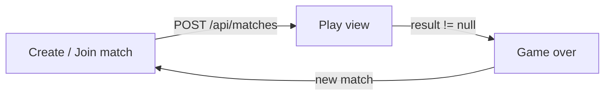
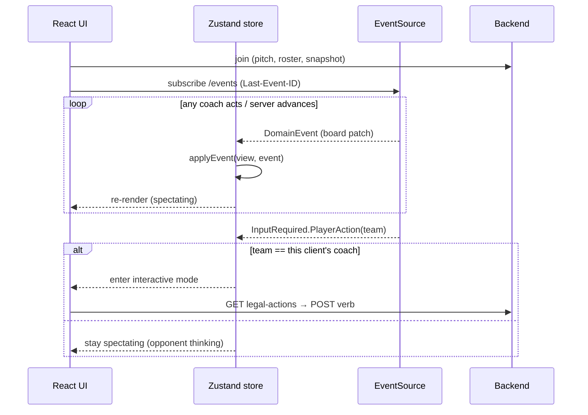
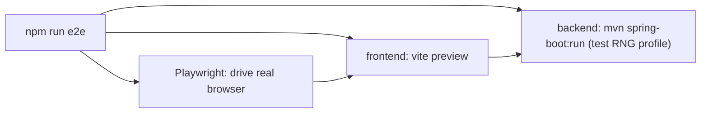

# Goblins & Gridirons — Frontend Architecture

Responsive GUI client for the Goblins & Gridirons engine API. The client **draws state and submits commands**; it never re-implements game rules. The backend is the single source of truth for legality, dice, turn flow, and scoring.

**Backlog:** [BACKLOG.md](../BACKLOG.md) (shared, Phases 10–15) · **System:** [ARCHITECTURE.md](../ARCHITECTURE.md) · **Backend:** [backend/ARCHITECTURE.md](../backend/ARCHITECTURE.md)

**Protocol source of truth:** [system § Client ↔ engine contract](../ARCHITECTURE.md#client--engine-contract-summary) and [backend § Event stream](../backend/ARCHITECTURE.md#event-stream-phase-9).

---

## Status

| Area | Phase | Status |
|------|-------|--------|
| App scaffold (Vite, React, TS strict, lint) | [10](../BACKLOG-done.md#phase-10-frontend-foundation) | Done |
| API type-sync (OpenAPI → TS) + thin client | [10b](../BACKLOG-done.md#phase-10b-api-type-sync-tooling) | Done |
| Pitch / piece rendering + roster + HUD | [11](../BACKLOG-done.md#phase-11-pitch--hud-rendering) | Done |
| Legal-action UX + command POSTs | [12](../BACKLOG-done.md#phase-12-interactive-actions) | Done |
| SSE subscribe + event-fold + reconnect | [13](../BACKLOG-done.md#phase-13-event-driven-live-updates) | Done |
| Assets / `AssetRegistry` / theming | [14](../BACKLOG-done.md#phase-14-assets--theming) | Done |
| Full-system Playwright e2e | [15](../BACKLOG-done.md#phase-15-full-system-e2e) | Done |

---

## Tech stack

| Concern | Choice | Why | Rejected |
|---------|--------|-----|----------|
| Build / dev server | **Vite** | Fast HMR, first-class TS, trivial Playwright `webServer` wiring | CRA (deprecated), Next.js (SSR/routing weight we do not need for a single-page game view) |
| UI | **React + TypeScript** (`strict`) | Requested; component model fits pitch + HUD + panels | — |
| State | **Zustand** store over a **pure reducer** | Event-fold is a pure function; store is a thin holder. Small, testable, no boilerplate | Redux Toolkit (ceremony), raw Context (re-render churn on every patch) |
| Server → client | **`EventSource`** (native SSE) | Backend ships SSE with `Last-Event-ID` reconnect; zero deps when same-origin | WebSocket (bidirectional not needed), polling |
| Rendering | **SVG** (`viewBox` scaling) | Responsive by construction, crisp tokens, DOM hit-testing for legal-move highlights, screen-reader friendly | Canvas (manual a11y + hit-testing, harder to black-box test) |
| Styling | **Plain CSS** (`src/index.css`) | Zero dependencies; CSS custom properties (`--color-*`) centralize theme tokens; media queries handle responsive layout | Tailwind (extra build dependency for one screen), CSS Modules |
| Unit / component tests | **Vitest + React Testing Library** | Fast, black-box, mirrors backend pure-domain testing | Jest (slower with Vite), enzyme (implementation-coupled) |
| End-to-end tests | **Playwright** | Real browser against real backend; black-box per global style | Cypress (heavier, weaker multi-server orchestration) |

TypeScript is configured `strict` with `noUncheckedIndexedAccess` and `exactOptionalPropertyTypes`. `any` is disallowed by lint; model backend sealed types as **discriminated unions** on the `kind` field (see [Talking to the backend](#talking-to-the-backend)).

---

## Directory layout

```text
frontend/
├── ARCHITECTURE.md          ← this file
├── .cursor/rules/           ← frontend Agent rules (style + scope)
├── index.html
├── package.json
├── vite.config.ts
├── playwright.config.ts
├── tsconfig.json
└── src/
    ├── main.tsx             ← app entry
    ├── app/                 ← routing / screens (create, play, game-over)
    ├── api/
    │   ├── generated/       ← openapi.ts (generated, committed, do NOT hand-edit)
    │   ├── client.ts        ← thin fetch wrapper (typed by generated shapes)
    │   └── stream.ts        ← EventSource subscription + reconnect
    ├── state/
    │   ├── boardView.ts     ← client-side view model (pieces, balls, HUD)
    │   ├── applyEvent.ts    ← PURE reducer: (view, DomainEvent) → view
    │   └── store.ts         ← Zustand store holding view + connection status
    ├── render/              ← Pitch (SVG), Token, HUD, Dugout, EventLog
    ├── assets/              ← see § Assets
    └── test/                ← Vitest setup, fixtures, event fixtures
```

- **`api/generated/`** is produced from the backend OpenAPI spec (see [API & DTO synchronization](#api--dto-synchronization)). It is committed for diffable review but never hand-edited.
- **`state/applyEvent.ts`** is the client mirror of the backend's event-driven fold — pure, exhaustively unit-tested, no React import.

---

## Screen map



- **Create / Join** — read `GET /api/catalog/teams` and `GET /api/catalog/pitches`; pick home team, away team, pitch; `POST /api/matches` returns `CreateMatchResponse` (`matchId` + opening `snapshot`).
- **Play view** — pitch (SVG), HUD (scores, turn, phase, actions remaining, active coach), legal-action panel (this coach's choices), event log (human-readable `DomainEvent` stream).
- **Game over** — final score + `MatchResult`; offer a new match.

### Seat identity

One browser can run **vs-computer** (one `HUMAN` + one `COMPUTER`) or **hotseat** (both `HUMAN`).

| Mode | “You” chip | Bonus hand / ability banners | Interactability |
|------|------------|------------------------------|-----------------|
| Vs-computer | Only the sole `HUMAN` seat | That seat | Human seat only when it is active |
| Hotseat (default) | Neither — both show **Hotseat** | Follows `activeCoach` (shared controls) | Whichever coach is active, if `HUMAN` |
| Explicit seat | `?coach=HOME` or `?coach=AWAY` (when that seat is `HUMAN`) | Preferred seat | Unchanged: still only the active human coach can submit |

`localCoach` in the match store is resolved by `resolveLocalCoach` (`state/seatIdentity.ts`). Optional `?coach=` is read at join and kept for the session; `?matchId=` sync preserves it.

---

## State model

Three data lifecycles, matching the backend's contract:

| Lifecycle | Source | When fetched | Maps to |
|-----------|--------|--------------|---------|
| **Static terrain** | `GET .../pitch` (`PitchLayoutDto`) | Once at join | Pitch grid, end zones, trapdoors, blocked squares |
| **Static cards** | `GET .../roster` (`MatchRosterDto` + `PlayerCardDto`) | Once at join | Player card labels/stats, keyed by `playerId` |
| **Mutable hydrate** | `GET .../snapshot` (`MatchSnapshotDto`) | At join and on reconnect gap | `lastEventId` + HUD (`MatchGameStateDto`) + pieces (`PieceSnapshotDto`) |
| **Streamed patches** | `GET .../events` (SSE, `DomainEvent`) | Continuously after subscribe | Incremental board mutations + `InputRequired` signals |

### The event-fold reducer

The client keeps a `BoardView` and folds each `DomainEvent` into it — the same denormalized, self-describing events the backend emits inline on action POSTs (see [DomainEvent.kt](../backend/src/main/kotlin/com/mhaefele/gridiron/game/action/dto/DomainEvent.kt)). Each event carries explicit `from`/`to`/`at` coordinates so no before/after diffing is needed:

```typescript
// state/applyEvent.ts — pure; no React, no fetch
export function applyEvent(view: BoardView, event: DomainEvent): BoardView {
    switch (event.kind) {
        case "playerMoved":        return movePiece(view, event.playerId, event.to);
        case "ballBounced":        return moveLooseBall(view, event.from, event.to);
        case "ballPickedUp":       return setHeldBall(view, event.playerId, true);
        case "touchdownScored":    return applyTouchdown(view, event.team);
        case "playerActionRequired": return view; // protocol signal — no board change
        // ... one arm per DomainEvent kind; exhaustive switch, no default fall-through
    }
}
```

`applyEvent` is exhaustive over the `kind` union; TypeScript flags any unhandled variant when the backend adds one — the primary drift alarm for event shape.

### When to patch vs re-hydrate

- **Normal play:** fold each streamed `DomainEvent` into the view. The local coach also receives an authoritative `snapshot` in every `MatchActionResponse`, used to reconcile after their own POST.
- **Reconnect with a known `Last-Event-ID`:** the backend replays missed events onto the new stream; keep folding.
- **Gap / uncertainty (e.g. dropped connection with no cursor):** re-fetch `GET .../snapshot` and reset the view, then re-subscribe with the fresh `lastEventId`.

### Known gap — HUD is not on the event stream

**Backend done ([13.6](../BACKLOG-done.md#task-136--turnprogress-events-on-the-stream-backend)):** the stream now also carries turn/progress beats — `teamActionConsumed`, `phaseStarted`, `matchEnded` — alongside board patches, `touchdownScored`, and `InputRequired`. A spectator can fold HUD from events alone.

**Frontend done:** `applyEvent` folds the turn/progress kinds; the [13.5](../BACKLOG-done.md#task-135--reconcile-hud-via-snapshot-refresh-frontend-v1-fallback) snapshot-refresh fallback is not used.

## The event-driven loop (responsiveness during the opponent's turn)

The core requirement: the UI stays responsive while it is **not** this coach's turn, applying updates as they arrive and only becoming interactive when the server explicitly asks this coach to act.



- A small **connection/turn state machine** — `connecting → hydrating → spectating → awaitingInput` — lives in the store. Board patches are applied in every state; **interactivity is gated only by `InputRequired.PlayerAction` addressed to the local coach**.
- Server-driven beats (pre-turn No Ball / Emergency Reserves, turn-end coach swap) arrive as ordered events and animate exactly like any other patch — the client does not POST `advance-turn` (the backend advances automatically; see [backend § Phase advancement](../backend/ARCHITECTURE.md#turn-and-match-progress)).
- **Scope note:** there is no server-side opponent yet (the bot is deferred [AI1](../BACKLOG.md#deferred--phase-ai1-basic-computer-opponent)) and no auth/seat model. "Opponent's turn" today means a second human client, or the server auto-advancing turns. The loop is designed for it now so adding a bot or a second seat needs no client rework.

---

## Talking to the backend

### Consumed endpoints

| Purpose | Endpoint | Response DTO |
|---------|----------|--------------|
| Catalog (create form) | `GET /api/catalog/teams`, `.../pitches` | `TeamCatalogDto`, `PitchCatalogDto` |
| Create match | `POST /api/matches` | `CreateMatchResponse` |
| Static terrain | `GET /api/matches/{id}/pitch` | `PitchLayoutDto` |
| Static cards | `GET /api/matches/{id}/roster` | `MatchRosterDto` |
| Mutable hydrate | `GET /api/matches/{id}/snapshot` | `MatchSnapshotDto` |
| Legal choices | `GET /api/matches/{id}/legal-actions` | `LegalAction[]` |
| Live stream | `GET /api/matches/{id}/events` | SSE `DomainEvent` frames |
| Actions | `POST .../players/{playerId}/{run\|mark\|sidestep\|throw\|block\|stand-up\|reserves}` | `MatchActionResponse` |

The client **must not invent wire shapes** or endpoints; it consumes only the DTOs above. Board geometry comes from `PitchLayoutDto` — the client never hardcodes pitch dimensions (default is 11×15 today, but that is data), and never re-derives rules from the rulebook PDF.

### API & DTO synchronization

**Convention: generate, do not copy.** Hand-written TS mirrors of Kotlin DTOs drift silently. Instead:

1. The backend exposes an **OpenAPI 3 document** (`springdoc-openapi`) at `/v3/api-docs`.
2. `openapi-typescript` generates **types only** into `src/api/generated/openapi.ts` via `npm run gen:api`. No runtime client classes are generated.
3. A **local drift guard** (`npm run gen:api:check`, optionally a git pre-commit hook — no cloud CI in this hobby project) regenerates and fails on any diff — the alarm that backend and frontend moved out of lockstep.
4. A thin, hand-written `src/api/client.ts` (fetch) and `src/api/stream.ts` (`EventSource`) are the only runtime code; both are typed by the generated shapes.

**Sealed-hierarchy caveat:** `DomainEvent` and `LegalAction` are Jackson polymorphic types with a `kind` discriminator ([DomainEvent.kt](../backend/src/main/kotlin/com/mhaefele/gridiron/game/action/dto/DomainEvent.kt), [LegalAction.kt](../backend/src/main/kotlin/com/mhaefele/gridiron/api/dto/response/LegalAction.kt)). The OpenAPI schema must emit these as `oneOf` + `discriminator: kind` so codegen yields TS **discriminated unions** (enabling the exhaustive `switch` in `applyEvent`). Verifying this is an explicit backend task in [Phase 10b](../BACKLOG-done.md#phase-10b-api-type-sync-tooling).

**Why not alternatives:** full client generators (openapi-generator → axios classes) add runtime ceremony that fights the thin-client goal; contract-tests-only detect drift late (at test run) instead of at compile time. Types-only codegen + a hand-written client is the minimum that still guarantees lockstep.

### Dev connectivity (CORS / proxy)

In dev the Vite server (`:5173`) and backend (`:8080`) are different origins. Use a **Vite dev proxy** (`server.proxy` for `/api`) so `fetch` and `EventSource` stay same-origin locally — this is the only piece needed for a local hobby setup ([Task 10.7](../BACKLOG-done.md#task-107--vite-dev-proxy)). A configurable **backend CORS** policy is optional/forward-looking for deployed cross-origin topologies and lives in the parking lot as [P.1](../BACKLOG.md#p1--backend-cors-if-ui-and-api-are-different-origins).

### Auth-forward note

`EventSource` cannot set headers, so it works today only with cookie/same-origin. When Bearer auth lands, swap `stream.ts` to a fetch-based SSE reader (`@microsoft/fetch-event-source`) — same wire format, isolated change.

---

## Rendering & responsiveness

- **Pitch** is one `<svg viewBox="0 0 w h">` sized to the play area from `PitchLayoutDto`; the container scales it responsively (CSS `width: 100%`, aspect-ratio locked). One `<g>` per square; overlays for end zones, trapdoors, blocked squares.
- **Tokens** are components keyed by `playerId`, positioned from `PieceSnapshotDto.players[].at`, styled by team + `PlayerStatus` (standing / prone / reserves) and `holdsBall`. Loose balls render from `looseBallLocations`.
- **Legal-move affordances:** highlight `LegalAction.targetCoordinate` squares; clicking a highlighted square (or a token for block/throw) dispatches the matching command. DOM hit-testing on SVG squares keeps this simple and testable.
- **Responsiveness:** layout collapses HUD + panels around the pitch on narrow viewports (CSS media queries); the pitch never overflows because it scales via `viewBox`.
- **Accessibility:** squares and tokens carry `aria-label`s (coordinate, occupant, status); the event log is an `aria-live` region so screen readers hear each beat.

---

## Assets

Generative AI art is treated as **swappable data** behind an indirection so files can be regenerated or replaced without touching render code.

**Two stages, on purpose:**

1. **First visuals (Phase 11) use no art files** — tokens are code-drawn SVG primitives (team-colored disc + position initial, dimmed/rotated when prone, ball glyph when carrying). This means a live board is on screen before any image exists.
2. **Art arrives in Phase 14 (Task 14.2)** — the generation prompts in [ART.md](ART.md) are the artifact for that step. They are portable: an image-capable agent can generate assets directly, or you can paste the same prompts into any external image AI and drop the files into `src/assets/`. Files then resolve through the `AssetRegistry`, replacing the primitives with zero render-code changes.

### Layout

```text
src/assets/
├── tokens/       ← player tokens: {team}-{position}-{status}.svg|png
│   ├── dwarves/  (lineman, runner, blitzer, doom-seeker)
│   └── orcs/     (lineman, thrower, blitzer, bruiser)
├── cards/        ← team card + (future) challenge card art
├── pitch/        ← board textures / end-zone / trapdoor decals
├── ui/           ← icons (ball, dice faces, score, action pips)
└── registry.ts   ← AssetRegistry: logical key → asset URL
```

- **SVG for tokens/icons** (crisp at any zoom, tiny, themeable via `currentColor`); **PNG for raster AI art** (card portraits, pitch textures). Start with **minimal viable flat tokens** and swap richer art later — the registry makes that a data change.

### AssetRegistry (indirection layer)

```typescript
// assets/registry.ts
type TokenKey = { team: TeamSide; position: string; status: "standing" | "prone" };

interface AssetRegistry {
    token(key: TokenKey): string;      // resolved URL, with a generic fallback per team
    icon(name: IconName): string;
    cardArt(teamId: string): string;
}
```

Render code asks the registry for a URL by **logical key**; it never imports a file path directly. Swapping `dwarves/blitzer.png` for a new render, or A/B-testing an art set, is a registry edit — zero component changes.

Art inventory, house style, and generation prompts live in [ART.md](ART.md).

---

## Testing

Per the global style ([code-style](../.cursor/rules/code-style.mdc), backend [testing-strategy](../backend/.cursor/rules/testing-strategy.mdc)): **black-box functional tests over brittle, mock-heavy unit tests.** Three layers, from cheapest to broadest:

| Layer | Tool | Covers | Mocks? |
|-------|------|--------|--------|
| **Pure reducer** | Vitest | `applyEvent` fold over `DomainEvent` fixtures, `BoardView` derivations | None — pure functions in, data out |
| **Component black-box** | Vitest + RTL | Render from real DTO fixtures; click a highlighted square → correct command dispatched; assert the DOM the user sees | Stub only the HTTP boundary with recorded real responses; never spy on internals |
| **End-to-end** | Playwright | Real browser + real backend + real Vite; a whole match | None |

- **Reducer tests are the bulk of coverage** — exhaustive over every `DomainEvent` kind, mirroring the backend's exhaustive pure-domain tests. Event fixtures are captured from real backend responses so they cannot drift into fiction.
- **Do not** assert which functions were called or that a component "called `fetch`" — assert the rendered board and the command payload, i.e. what the user and server observe.
- **Full-system e2e** (see next section) is kept intentionally small: one create-and-play smoke plus one full-match invariant run.

---

## Full-system integration testing (Playwright)

Goal: a single command boots the real backend, the real frontend, and drives a live match through the browser — end-to-end black box.



- **Orchestration:** Playwright `webServer` entries boot both servers (backend jar/`spring-boot:run`, then Vite `preview`), wait for health, run specs, tear down. One `npm run e2e`.
- **Determinism enabler (backend done — [15.1](../BACKLOG-done.md#task-151--seedable-rng-backend-test-profile-enabler)):** boot with `--spring.profiles.active=scripted-dice`. Uses shared `ScriptedDiceRoller` (default pattern when queues empty); e2e can `POST /api/test/dice/d6|d8|block` with `{ "values": [...] }` to force the next rolls. Unit/API tests activate profile `test` with fallback off (throw if unqueued). Production stays on `RandomDiceRoller`. Where scripts leave randomness, assert **invariants** (occupancy consistent, score non-decreasing except touchdowns, "match reaches GAME_OVER"), not exact squares.
- **Black-box only:** specs interact via the real UI (clicks, visible text) and assert visible outcomes — no injected app state, no mocked network. This is the frontend analogue of the backend's whole-stack API tests.

---

## Out of scope (owned by backend)

- Rulebook checks, dice, turn engine, persistence, scoring.
- Inventing wire shapes or endpoints not returned by the API.
- Encoding legality beyond what `GET .../legal-actions` and the event stream already convey.

---

## Related documents

- [System architecture](../ARCHITECTURE.md) — monorepo layout, cross-module boundaries, client↔engine contract
- [Backend architecture](../backend/ARCHITECTURE.md) — rules engine, API, event stream
- [BACKLOG.md](../BACKLOG.md) — shared checklist; frontend work is Phases 10–15
- [ART.md](ART.md) — every art set: inventory, house style, prompts, team and position briefs
- [`frontend/.cursor/rules/`](.cursor/rules/) — frontend Agent conventions (style + scope)
